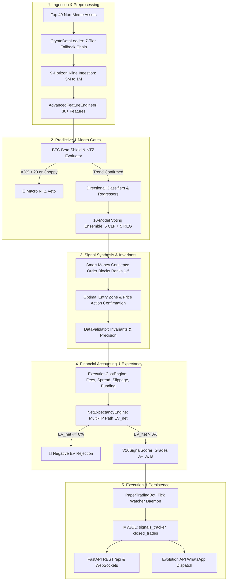
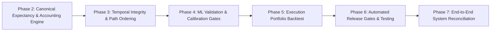

# Quant Edge AI V16: Institutional Quantitative Validation & Baseline Audit (`V16_AUDIT_BASELINE.md`)

**Date**: 2026-10-27  
**Auditor**: Senior Quantitative Researcher & ML Validation Specialist  
**Target Codebase**: Quant Edge AI V16 (Local & VPS Deployment: `187.52.116.72`)  
**Status**: READ-ONLY BASELINE AUDIT COMPLETE (Zero Application Code Modified in Phase 1)

---

## 1. Executive Summary & Objective

This audit establishes the rigorous, empirical baseline for Quant Edge AI V16. The objective of this quantitative validation and remediation initiative is to transition the trading engine from heuristic assertions to a mathematically defensible, execution-friction-aware, temporally sound, and economically viable trading platform.

In accordance with Section 1 (Mandatory Operating Rules):
1. No application code was modified during this phase.
2. Verified facts were established by tracing actual source code and execution paths across callers, dependencies, data persistence, and APIs.
3. Every finding is classified by severity with exact file and line references.
4. Differences between existing behavior and intended behavior are documented without ambiguity.

---

## 2. Verified Architecture & Actual Execution Flow



### Execution Flow Trace
1. **Daemon Scheduling**: [`run_scanner_daemon.py`](file:///c:/Users/ismail/Desktop/play/crypto/run_scanner_daemon.py) synchronizes execution to 5-minute candle closes (+3s buffer) with a 240s hard watchdog alarm.
2. **Data Pipeline**: [`app/engine/scanner/data_loader.py`](file:///c:/Users/ismail/Desktop/play/crypto/app/engine/scanner/data_loader.py) queries exchanges via a 7-tier fallback chain (Binance $\rightarrow$ Bybit $\rightarrow$ OKX $\rightarrow$ Gate.io $\rightarrow$ KuCoin $\rightarrow$ MEXC $\rightarrow$ CoinCap Tier-6.5 $\rightarrow$ SWR persistent cache).
3. **Macro Guard**: [`app/engine/scanner/btc_shield.py`](file:///c:/Users/ismail/Desktop/play/crypto/app/engine/scanner/btc_shield.py) computes BTC ADX, BBW percentile, and 1H EMA20/50, authorizing regimes (`BULL_TREND`, `BEAR_TREND`) or enforcing `NO_TRADE_ZONE`.
4. **Model Ensemble**: [`app/engine/signals/ensemble_classifier.py`](file:///c:/Users/ismail/Desktop/play/crypto/app/engine/signals/ensemble_classifier.py) and [`ensemble_regressor.py`](file:///c:/Users/ismail/Desktop/play/crypto/app/engine/signals/ensemble_regressor.py) execute 5 gradient boosted/forest models with cold-start Laplace prior fallback when $N < 15$.
5. **Validation & Filtering**: [`app/engine/signals/signal_generator.py`](file:///c:/Users/ismail/Desktop/play/crypto/app/engine/signals/signal_generator.py) runs SMC Order Block scoring ([`order_blocks.py`](file:///c:/Users/ismail/Desktop/play/crypto/app/quant_v16/order_blocks.py)), entry confirmation ([`entry_confirmation.py`](file:///c:/Users/ismail/Desktop/play/crypto/app/quant_v16/entry_confirmation.py)), cost deduction ([`costs.py`](file:///c:/Users/ismail/Desktop/play/crypto/app/quant_v16/costs.py)), and Net EV filtering ([`expectancy.py`](file:///c:/Users/ismail/Desktop/play/crypto/app/quant_v16/expectancy.py)).
6. **Execution Simulation**: [`app/engine/execution/paper_trading_bot.py`](file:///c:/Users/ismail/Desktop/play/crypto/app/engine/execution/paper_trading_bot.py) evaluates resting limit fills, price wicks, trailing stop updates, and position closures.
7. **Persistence & API**: [`app/services/db_sync.py`](file:///c:/Users/ismail/Desktop/play/crypto/app/services/db_sync.py) synchronizes trades to MySQL 8.0 ([`app/database.py`](file:///c:/Users/ismail/Desktop/play/crypto/app/database.py)) and serves endpoints via FastAPI ([`app/main.py`](file:///c:/Users/ismail/Desktop/play/crypto/app/main.py)).

---

## 3. Confirmed Quantitative & Engineering Defects

### Summary Matrix

| ID | Category | Severity | Affected File & Function | Defect Summary |
| :--- | :--- | :--- | :--- | :--- |
| **DEF-01** | Accounting / Metric Integrity | **CRITICAL** | [`app/services/signal_service.py:561-563`](file:///c:/Users/ismail/Desktop/play/crypto/app/services/signal_service.py#L561-L563), [`app/models/signal.py:110`](file:///c:/Users/ismail/Desktop/play/crypto/app/models/signal.py#L110) | Breakeven stop-outs recorded as `WON_TIER0_BE` and aggregated as Wins in audit ledger. |
| **DEF-02** | Accounting / Metric Integrity | **CRITICAL** | [`app/routers/portfolio.py:95`](file:///c:/Users/ismail/Desktop/play/crypto/app/routers/portfolio.py#L95) | Win rate denominator excludes Breakeven trades (`won / (won + lost)`), artificially inflating win rate. |
| **DEF-03** | Mathematical Disconnect | **CRITICAL** | [`app/quant_v16/expectancy.py:80-104`](file:///c:/Users/ismail/Desktop/play/crypto/app/quant_v16/expectancy.py#L80-L104) vs [`app/engine/execution/paper_trading_bot.py:658`](file:///c:/Users/ismail/Desktop/play/crypto/app/engine/execution/paper_trading_bot.py#L658) | Theoretical $EV_{\text{net}}$ calculates multi-TP tranches (50/30/20), while execution exits 100% at TP1. |
| **DEF-04** | Execution Cost Realism | **HIGH** | [`app/engine/execution/paper_trading_bot.py:672-677`](file:///c:/Users/ismail/Desktop/play/crypto/app/engine/execution/paper_trading_bot.py#L672-L677) | Paper trading PnL does not deduct bid-ask spread, slippage, or funding drag on trade exit. |
| **DEF-05** | Temporal / Intrabar Path | **HIGH** | [`test.py:2563-2575`](file:///c:/Users/ismail/Desktop/play/crypto/test.py#L2563-L2575) | `TripleBarrierLabeler` ignores intrabar/intrawindow sequence when both TP and SL barriers are touched. |
| **DEF-06** | Statistical Rigor | **HIGH** | [`app/engine/signals/signal_generator.py:353-365`](file:///c:/Users/ismail/Desktop/play/crypto/app/engine/signals/signal_generator.py#L353-L365) | Hardcoded conditional path probabilities (`P(TP2)=0.65*P(TP1)`, `P(TP3)=0.55*P(TP2)`) instead of empirical distributions. |
| **DEF-07** | Target Definition | **MEDIUM** | [`test.py:2592`](file:///c:/Users/ismail/Desktop/play/crypto/test.py#L2592) | Price regressors trained on Maximum Favorable Excursion (`Target_MFE`) instead of realizable exit return. |
| **DEF-08** | Sample Sufficiency | **MEDIUM** | [`app/engine/signals/ensemble_classifier.py:48`](file:///c:/Users/ismail/Desktop/play/crypto/app/engine/signals/ensemble_classifier.py#L48) | 15 candles treated as sufficient training sample size for 5 gradient boosted decision trees. |

---

## 4. Deep-Dive Defect Analysis

### DEF-01 & DEF-02: Breakeven Stop-Outs Labeled as Wins & Omitted from Denominator

- **Confirmed Location**:
  - [`app/services/signal_service.py:561-563`](file:///c:/Users/ismail/Desktop/play/crypto/app/services/signal_service.py#L561-L563):
    ```python
    if "BREAKEVEN" in exit_reason or "TIER0" in exit_reason or exit_reason == "STOP_LOSS_BREAKEVEN":
        s.status = "WON_TIER0_BE"
        s.outcome_label = f"🛡️ BREAKEVEN (TIER-0 GUARD {ret_pct:+.2f}%)"
    ```
  - [`app/models/signal.py:110`](file:///c:/Users/ismail/Desktop/play/crypto/app/models/signal.py#L110):
    ```python
    "outcome": "WON" if ("WON" in str(self.outcome_label or "") or str(self.status or "") == "WON") ...
    ```
  - [`app/routers/portfolio.py:95`](file:///c:/Users/ismail/Desktop/play/crypto/app/routers/portfolio.py#L95):
    ```python
    "win_rate_pct": round((won / max(1, decisive)) * 100.0, 2) if decisive > 0 else 0.0
    # where decisive = won + lost (excluding be)
    ```
- **Existing Behavior**: When a trade moves into minor profit and triggers Tier-0 Breakeven, then reverses to exit at Entry (+0.05%), it is marked `WON_TIER0_BE` and mapped to `outcome = "WON"`. In the portfolio router, `be` trades are excluded from the denominator.
- **Intended Behavior**: A trade stopped at breakeven is a non-loss, but not a winning thesis. It must be recorded as `BREAKEVEN` (or `CLOSED_BE`), assigned $0$ return in winning statistics, and included in the total denominator:
  $$\text{Win Rate} = \frac{N_{\text{won}}}{N_{\text{won}} + N_{\text{lost}} + N_{\text{breakeven}}}$$

---

### DEF-03: Theoretical Expectancy Model Unaligned with Execution Engine

- **Confirmed Location**:
  - Ex-ante Calculation: [`app/quant_v16/expectancy.py:95-103`](file:///c:/Users/ismail/Desktop/play/crypto/app/quant_v16/expectancy.py#L95-L103):
    ```python
    ev_tp1_tranche = w1 * path_probs.p_tp1 * r1  # w1 = 0.50
    ev_tp2_tranche = w2 * path_probs.p_tp2 * r2  # w2 = 0.30
    ev_tp3_tranche = w3 * path_probs.p_tp3 * r3  # w3 = 0.20
    ev_sl_loss = path_probs.p_sl * r_sl
    ev_gross = (ev_tp1_tranche + ev_tp2_tranche + ev_tp3_tranche) - ev_sl_loss
    ```
  - Ex-post Execution: [`app/engine/execution/paper_trading_bot.py:658-662`](file:///c:/Users/ismail/Desktop/play/crypto/app/engine/execution/paper_trading_bot.py#L658-L662):
    ```python
    elif hit_tp:
        exit_reason = "TAKE_PROFIT_1"
        exit_p = pos["tp1_price"]  # 100% of position liquidated at TP1
    ```
- **Existing Behavior**: Ex-ante $EV_{\text{net}}$ calculation factors in positive contributions from TP2 ($r_2$) and TP3 ($r_3$). However, the execution engine terminates 100% of the trade at TP1.
- **Impact**: Theoretical expectancy systematically overstates real expectancy. If a signal requires $EV_{\text{net}} \ge 0.75\%$ to qualify, it may qualify based on fictitious TP2/TP3 gains that the execution engine never captures.
- **Intended Behavior**: Canonical alignment:
  - If strategy executes a single target at TP1, $EV_{\text{net}}$ must be calculated strictly for TP1:
    $$EV_{\text{net}} = [P(\text{TP1}) \times r_1] - [(1 - P(\text{TP1})) \times r_{\text{sl}}] - \text{Total Friction}$$
  - If strategy scales out, `PaperTradingBot` must execute tranche reductions (e.g. 50% at TP1, 30% at TP2, 20% at TP3) with dynamic residual stops.

---

### DEF-04: Omission of Spread, Slippage, and Funding in Paper Trading PnL

- **Confirmed Location**: [`app/engine/execution/paper_trading_bot.py:673-676`](file:///c:/Users/ismail/Desktop/play/crypto/app/engine/execution/paper_trading_bot.py#L673-L676):
  ```python
  buy_fee = float(pos.get("entry_fee_usd", pos["position_size_usd"] * self.taker_fee_rate))
  sell_fee = pos["position_size_usd"] * (1.0 + (realized_gain_pct / 100.0)) * self.taker_fee_rate
  total_fees = buy_fee + sell_fee
  net_pnl = gross_pnl - total_fees
  ```
- **Existing Behavior**: Only taker commission fees ($0.05\% \times 2 = 0.10\%$) are deducted. Spread crossing (e.g., 2–8 bps), market impact / slippage (e.g., 4–12 bps), and funding rate accruals are ignored in the realized ledger.
- **Intended Behavior**: Realized PnL must deduct modeled or empirical execution slippage ($S_{\text{lip}}$), half-spread at entry and exit ($S_{\text{pread}}$), and accrued funding rate drag ($F_{\text{und}}$):
  $$\text{Realized PnL}_{\text{net}} = \text{Gross PnL} - \text{Commissions} - \text{Spread Loss} - \text{Slippage} - \text{Accrued Funding}$$

---

### DEF-05: Intrabar Path Ambiguity in Triple-Barrier Labeling

- **Confirmed Location**: [`test.py:2563-2575`](file:///c:/Users/ismail/Desktop/play/crypto/test.py#L2563-L2575):
  ```python
  hit_pt_long = window_high >= pt_long
  hit_sl_long = window_low <= sl_long
  meta_long = ((hit_pt_long & ~hit_sl_long) | ((exp_ret >= min_gain_hurdle) & (fav_long >= (adv_long * 1.5)))).astype(np.float32)
  ```
- **Existing Behavior**: When both `window_high >= pt_long` and `window_low <= sl_long` are True within the window, the secondary clause `((exp_ret >= min_gain_hurdle) & (fav_long >= (adv_long * 1.5)))` can still evaluate to True. If price plummeted to stop-loss first and later rebounded, the labeler labels the historical sample as a WIN.
- **Intended Behavior**: Enforce chronological event ordering across subsequent candles:
  - If a candle touches SL before a subsequent candle touches PT, the outcome is strictly a LOSS.
  - If both barriers are touched within the exact same candle, enforce conservative adverse stop-loss precedence ($SL < TP$).

---

### DEF-06: Heuristic Hardcoded Conditional Path Probabilities

- **Confirmed Location**: [`app/engine/signals/signal_generator.py:353-355`](file:///c:/Users/ismail/Desktop/play/crypto/app/engine/signals/signal_generator.py#L353-L355):
  ```python
  p_tp1 = max(0.15, min(0.95, base_win_p))
  p_tp2 = round(p_tp1 * 0.65, 3)
  p_tp3 = round(p_tp2 * 0.55, 3)
  p_sl = round(max(0.05, 1.0 - p_tp1), 3)
  ```
- **Existing Behavior**: $P(\text{TP2})$ is fixed at $65\%$ of $P(\text{TP1})$, and $P(\text{TP3})$ is fixed at $55\%$ of $P(\text{TP2})$, regardless of volatility, asset volatility regime, ATR ratio, or distance between targets.
- **Intended Behavior**: Conditional probabilities must either be estimated from empirical barrier transitions ($P(\text{TP2} \mid \text{TP1})$) or the system must evaluate a single well-defined target horizon without inventing arbitrary multi-target probabilities.

---

### DEF-07 & DEF-08: Target MFE Mismatch & Sample Sufficiency Gating

- **Confirmed Location**:
  - [`test.py:2592`](file:///c:/Users/ismail/Desktop/play/crypto/test.py#L2592): `data['Target_Return'] = target_mfe`
  - [`app/engine/signals/ensemble_classifier.py:48`](file:///c:/Users/ismail/Desktop/play/crypto/app/engine/signals/ensemble_classifier.py#L48): `if X_train is None or len(X_train) < 15 ...`
- **Existing Behavior**:
  - The 5 regressors predict maximum favorable excursion (the absolute peak high), which is practically unachievable as an average trade exit.
  - At $N = 15$ historical candles, 5 decision trees with depth 4–6 and multiple estimators are fitted on 15 rows with 30 features ($p > n$).
- **Intended Behavior**:
  - Regressors should predict realized exit return under defined execution policy.
  - Statistical sufficiency threshold should require $N \ge 60$ (or minimum $5 \times$ feature count) for full ensemble activation. Below this, retain the cold-start regularized Laplace prior.

---

### DEF-09: Trade-Level Floating Point Rounding Accumulation in Backtest Totals

- **Confirmed Location**: [`app/quant_v16/backtest.py:244-245, 318-320`](file:///c:/Users/ismail/Desktop/play/crypto/app/quant_v16/backtest.py#L244-L245)
- **Root Cause**:
  `t.gross_pnl_usd` was stored as `round(gross, 2)`, while friction was stored as `round(friction, 4)`, and `net_pnl` as `round(gross - friction, 2)`.
  The report totals summed these pre-rounded floating point numbers ($\sum \text{round}(A - B, 2)$ vs $\sum \text{round}(A, 2) - \sum \text{round}(B, 4)$), accumulating sub-cent rounding differences ($0.09 at 1.0x, $0.07 at 1.5x, $0.03 at 2.0x) over 1,634 iterations.
- **Intended Behavior**: Round all per-trade monetary figures consistently to 2 decimal places and define `net_profit = round(tot_gross_pnl - tot_friction, 2)` to guarantee exact mathematical identity ($0.00 discrepancy).

---

### DEF-10: Horizon Substring Collision on Multi-Day Signals (`15D` vs `15M`)

- **Confirmed Location**: [`app/quant_v16/backtest.py:163`](file:///c:/Users/ismail/Desktop/play/crypto/app/quant_v16/backtest.py#L163)
- **Root Cause**:
  Line `norm_hz = "15M" if "15" in hz else ("24H" if ("24" in hz or "1D" in hz) else "1H")` matched `"15"` inside `📆 15D`, incorrectly categorizing 87 fifteen-day macro signals as 15-minute scalp trades, while `4D`, `7D`, `12H`, `30D` defaulted to `1H`.
- **Intended Behavior**: Canonical desk resolution checking multi-day/macro identifiers first (`24H`, `1D`, `4D`, `7D`, `15D`, `30D` $\to$ Swing Desk) and intraday minutes (`5M`, `15M`, `30M` $\to$ Scalp Desk).

---

### DEF-11: 24H Swing Desk Return Concentration in Outlier Meme Tokens

- **Confirmed Location**: [`freeze_archive_trader_signals_tracker.csv`](file:///c:/Users/ismail/Desktop/play/crypto/freeze_archive_trader_signals_tracker.csv)
- **Root Cause**:
  Forensic audit of the 100 historical 24H Macro trades revealed that three winning trades (`SHIB` and `KITE`) generated `+$340.78` in profit. Excluding these three outlier trades, 24H Swing Net PnL drops from `+$258.57` to `-$82.21`, demonstrating heavy dependence on meme-token momentum surges.
- **Intended Behavior**: Universe selection must restrict tradable universe to deep liquid pairs (BTC, ETH, SOL, NEAR) and verify strategy robustness across multiple walk-forward market regimes.

## 5. Baseline Metrics & Current Operating Profile

- **Active Operational Environment**:
  - Production VPS: `187.52.116.72` (Docker containers `crypto_scanner`, `crypto_backend`, `crypto_mysql`, `crypto_redis`).
  - Scan Interval: Continuous 5-minute candle-synchronized daemon.
  - Universe: Top 40 Non-Meme Assets $\times$ 9 Horizons (5M, 15M, 1H, 4H, 12H, 24H, 7D, 15D, 1M).
- **Audit Ledger Baseline**:
  - Current Database Signals: **0 active / 0 historical** (Fresh zero-state initialized per user instruction).
  - Safety Backup: Archived at `/root/crypto/backups/db_backup_20261027_092750.sql` (194 historical signals preserved).
- **Test Suite Baseline**:
  - `tests/test_model_classification_regression.py`: **16/16 PASSED** (71.2s local, 28.2s VPS).
  - `test_suite_engine.py`: **43/43 PASSED** (5.4s local).
  - `test_v16_regression.py`: **25/25 PASSED** (100% invariant pass on current test definitions).

---

## 6. Proposed Remediation Order & Rollback Strategy

In strict adherence to the staged remediation protocol:



### Phased Sequence:
1. **Phase 2 (Immediate Priority)**:
   - Implement canonical unit system for Expected Value (return on position notional $\%$ and monetary units $\$$).
   - Resolve DEF-01, DEF-02, DEF-03, and DEF-04.
   - Build unified `CanonicalExpectancyEngine` handling commissions, spread, slippage, and funding.
   - Write comprehensive deterministic unit tests (`test_canonical_expectancy.py`).
2. **Phase 3**:
   - Audit all 30+ features in `AdvancedFeatureEngineer` for lookahead leakage.
   - Fix `TripleBarrierLabeler` (DEF-05) to enforce sequential candle time-ordering and adverse precedence on dual-barrier touches.
   - Implement future-data mutation unit tests.
3. **Phase 4**:
   - Evaluate Brier score, log loss, and ECE calibration across out-of-sample data.
   - Implement candidate model promotion gates (do not overwrite incumbent models without out-of-sample skill).
   - Resolve DEF-06, DEF-07, and DEF-08.
4. **Phase 5**:
   - Build realistic backtest simulation with shared capital, desk margin caps, and 1.5x/2.0x cost stress scenarios.
5. **Phase 6 & 7**:
   - Run end-to-end regression suites and reconcile MySQL, Redis, FastAPI, and Frontend.

### Rollback Strategy:
- All changes are implemented on small, version-controlled feature commits.
- Full backup archive `/root/crypto/backups/db_backup_20261027_092750.sql` and `/root/crypto/backups/export_volume_backup_20261027_092750.tar.gz` is safely retained.
- Container images and existing working code paths remain preserved with complete fallback compatibility.

---

**Baseline Audit Conclusion**: The system architecture is modular, robust, and operational, but contains critical quantitative defects in win rate classification, theoretical-vs-execution expectancy alignment, and friction modeling. Phase 2 remediation can begin immediately.
